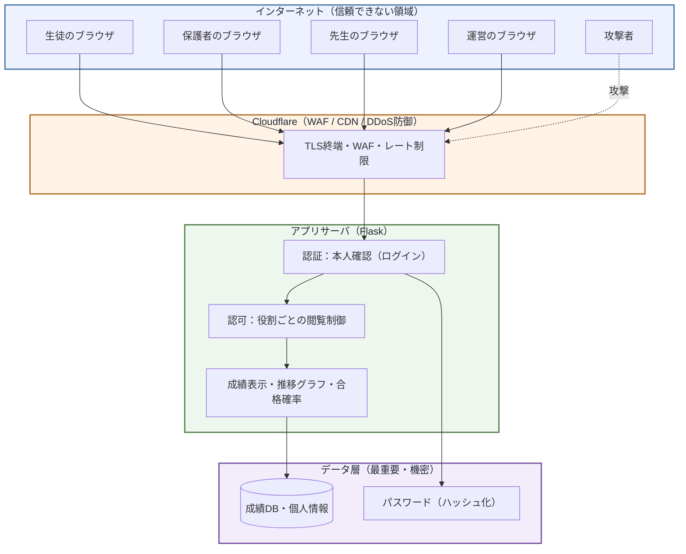
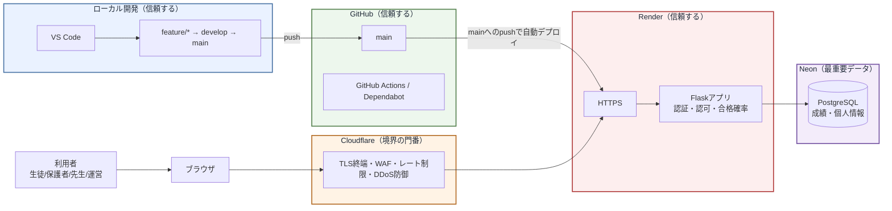

# 学習塾 成績管理アプリ — 要件定義・設計書

2026-11-16

学習塾向けの成績管理アプリ。生徒・保護者・先生・運営が、それぞれの立場に応じた範囲だけ成績を閲覧できる。本書は実装前に決めておく要件と設計をまとめたもの。

---

## 1. 方針

- 完全に安全なシステムは作れず、攻撃側が有利。だから企画・設計の段階から先手でセキュリティを組み込み、運用しながら更新し続ける。
- 判断（要件・設計・合格確率ロジック・リリース可否）は人間が決め、作業を自動化する。
- 不要な個人情報は持たない。持たなければ漏れない。

---

## 2. 対象ユーザーと役割（認証と認可）

| 役割 | 誰か | 見てよい範囲 | 書いてよい範囲 |
|---|---|---|---|
| 生徒 | 塾の子供 | 自分の成績・推移だけ | なし |
| 保護者 | 生徒の親 | 自分の子供の成績・推移だけ | なし |
| 先生 | 講師 | 全生徒の成績・推移 | 成績の記録・編集 |
| 運営 | 管理者 | 全生徒＋志望校合格確率 | 全体管理 |

- 認証（誰か）と認可（何をしてよいか）は別物。本アプリ最大の肝は認可。
- 最小権限・ゼロトラスト。保護者は自分の子のみにスコープを限定する。

---

## 3. 機能要件

| # | 要件 | 役割 |
|---|---|---|
| F1 | ログインして本人確認できる | 全員 |
| F2 | 自分の成績（5教科）を閲覧 | 生徒 |
| F3 | 自分の成績の推移をグラフで見る | 生徒 |
| F4 | 自分の子供の成績の推移を見る | 保護者 |
| F5 | 全生徒の成績の推移を見る | 先生 |
| F6 | 全生徒の推移＋志望校合格確率を見る | 運営 |

教科：国語・数学・英語・理科・社会。合格確率の算定ロジックは人間が定義する。

---

## 4. 扱うデータと分類

- 情報を公開／社内／機密に分類する。成績・志望校・合格確率は機密。
- 住所・電話など不要な個人情報は扱わない。
- CIA：機密性（他人の成績を見せない）／完全性（勝手に書き換わらない）／可用性（必要時に見られる）。
- データを持つ者に責任が伴う。漏えい時は報告義務。成績は改ざん動機が強い点に注意。
- 開発はダミーデータのみ。個人情報をAIに渡さない（必要ならマスキングまたは端末側処理）。

---

## 5. 論理アーキテクチャ構成図

色はサーバー（層）の区別用（外部／Cloudflare／アプリ／データ）。

---

## 6. デプロイ構成図（本番の技術スタック）

実際にどの技術をどう繋ぐか。点線のまたぎが信頼境界。

信頼境界：①ブラウザ↔Cloudflare ②Cloudflare↔Render ③Render↔Neon ④ローカル↔GitHub。秘密情報の `.env` はGit管理外、使用ツールはバージョンを明記する。

---

## 7. 信頼境界（Trust Boundary）

| # | 境界 | 信頼できない側 → 信頼できる側 |
|---|---|---|
| B1 | インターネット ↔ Cloudflare | 外部の全員（攻撃者含む）が入る最前線 |
| B2 | Cloudflare ↔ アプリサーバ | 認証を通った人だけが中に入る |
| B3 | アプリ ↔ データ層 | アプリ経由でしかDBに触れない |
| B4 | 役割間（アプリ内の認可） | 生徒・保護者・先生・運営で見える範囲が違う ← 本アプリの肝 |

---

## 8. 脅威と対策（STRIDE）

STRIDE = なりすまし / 改ざん / 否認 / 情報漏洩 / サービス妨害 / 権限昇格

| 境界 | 脅威 | 具体例 | 対策 |
|---|---|---|---|
| B1 | サービス妨害 | 大量アクセスでサイトを落とす | Cloudflareのレート制限・DDoS防御 |
| B1 | 情報漏洩 | 通信を盗聴して成績を覗く | HTTPS(TLS)を必須にする |
| B1 | なりすまし | 他人のID/PWでログイン | 強いパスワード＋多要素認証、ログイン試行の制限 |
| B4 | 権限昇格 | 生徒が運営ページ（合格確率）を見る | サーバ側で毎回ロールを確認。画面を隠すだけでは不十分 |
| B4 | 情報漏洩(IDOR) | URLのIDを書き換えて他人の成績を見る | リクエストごとに「見てよいデータか」を照合 |
| B3 | 改ざん | SQLインジェクションで点数を書換 | パラメータ化クエリ |
| B3 | 情報漏洩 | DBが平文で丸見え | パスワードはハッシュ化、機微情報は暗号化 |
| B3/B4 | 否認 | 誰が成績を変えたか不明 | 監査ログ（いつ・誰が・何をしたか記録） |

被害の大きいものから対応する。本アプリで最も痛いのは B4（認可）による情報漏洩。まずここを固める。

---

## 9. セキュリティ要件

| # | リスク | 対策 |
|---|---|---|
| S1 | SQLインジェクション | プレースホルダ（文字列連結しない） |
| S2 | OSコマンドインジェクション | 外部コマンドに入力を渡さない |
| S3 | XSS（格納型含む） | 出力は必ずエスケープ。テンプレの `safe` 出力を使わない |
| S4 | 情報のハードコード | 秘密情報は `.env`（Git管理外）。キー混入を検知 |
| S5 | 認可の不備（IDOR） | URL/IDを変えても他人の成績を見せない。毎回スコープ照合 |
| S6 | 権限チェック漏れ | サーバ側で毎回ロール確認 |
| S7 | 外部API無応答 | タイムアウト・例外・フォールバック |
| S8 | パスワード平文保存 | ハッシュ＋ソルト＋ストレッチング |
| S9 | セッション鍵の固定・直書き | 環境変数の強いランダム値。固定だと偽Cookieで運営になりすまされる |
| S10 | ログイン試行し放題 | レート制限＋監視 |
| S11 | パストラバーサル（`../`） | ファイル名検証・基準ディレクトリ外に出さない |
| S12 | 監査ログ無し | ログイン・成績変更を「誰が・いつ」記録 |
| S13 | 本番で開発サーバ／root実行 | 本番WSGI・コンテナは非root |
| S14 | 通信の暗号化 | HTTPS(TLS)必須 |

---

## 10. 技術スタック

| 層 | 採用 |
|---|---|
| フロント | ブラウザ（HTML/CSS/JS） |
| ローカル開発 | VS Code ＋ Gitブランチ（feature/* → develop → main） |
| バージョン管理 | GitHub（mainへpushで自動デプロイ）／GitHub Actions・Dependabot |
| サーバー | Render（PaaS）＋ Flask（Python） |
| DB | Neon（PostgreSQL） |
| 門番 | Cloudflare（TLS・WAF・レート制限・DDoS防御） |
| コンテナ | Docker（隔離・配布・スキャン） |

信頼できる既存のフレームワーク・ライブラリを使い、独自実装を避ける。使用ツールはバージョンまで記載する。

---

## 11. 開発・運用の進め方

1. ドキュメント整備（本書・仕様・セキュリティ要件・作業ルール）
2. 環境で縛る（コンテナ等で、ルールを物理的に守らせる）
3. テスト駆動（失敗するテスト → 最小実装 → リファクタ）。テスト一覧にない機能は作らない
4. 実装後にドキュメントとの差分を確認する
5. GitHubで管理。mainは必ず動くもの。マージ可否は分かる人間が判断。テスト/ルールの書き換えを自動検知
6. 継続的点検：コード監査（`cloudflare/security-audit-skill`）、動的スキャン（OWASP ZAP）、依存更新（Dependabot）
7. バックアップは別の場所に保管し、復元できることを確認する
8. 運用しながら更新し続ける

---

## 12. 完了条件

- [ ] 4役割でログインでき、見える範囲が役割どおりに制限される（F1〜F6）
- [ ] URL/ID直打ちで他人・他家庭のデータに届かない（S5・S6）／保護者は自分の子のみ
- [ ] パスワードが平文保存でない（S8）／セッション鍵が環境変数（S9）
- [ ] SQLi・XSSが成立しない（S1・S3）／秘密情報がハードコードされていない（S4）
- [ ] 成績変更の監査ログが残る（S12）
- [ ] テストがすべて通る

---

## 13. 対象外

- 本番運用（実在の生徒データの取り扱い）。学習用・ダミーデータのみ。
- 決済・課金。
- 入力/編集UIを足す場合は、書き込み認可（先生のみ等）を別途要件化する。

---

### 参考

IPA「安全なウェブサイトの作り方」「セキュリティ・バイ・デザイン導入指南書」／OWASP Top 10・ASVS・Cheat Sheet／MITRE ATT&CK／NIST SP800-61r3／書籍『セキュア・バイ・デザイン 安全なソフトウェア設計』
