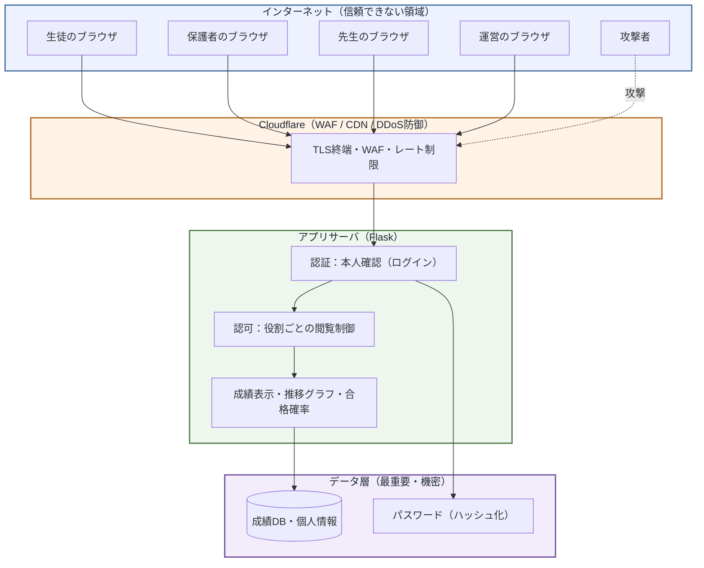
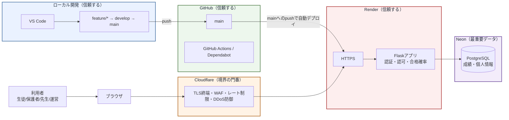

# 学習塾 成績管理アプリ — 設計と脅威分析

2026-11-16

## 1. 要件

- 生徒：自分の成績／自分の成績の推移を見られる
- 保護者：自分の子供の成績の推移を見られる
- 先生：すべての生徒の成績の推移を見られる
- 運営：すべての生徒の成績の推移 ＋ 志望校への合格確率を見られる

ポイントは「**誰が・誰のデータを・どこまで**見られるか」。役割（ロール）ごとに閲覧できる範囲の境界がある。

## 2. 構成図（論理アーキテクチャ）

色はサーバー（層）の区別用（外部／Cloudflare／アプリ／データ）。

## 3. デプロイ構成図（本番の技術スタック）

実際にどの技術をどう繋ぐか。点線のまたぎが信頼境界。

信頼境界（線をまたぐ所）：①ブラウザ↔Cloudflare ②Cloudflare↔Render ③Render↔Neon ④ローカル↔GitHub。秘密情報の `.env` はGit管理外、使用ツールはバージョンを明記する。

## 4. 信頼境界（Trust Boundary）

| # | 境界 | 信頼できない側 → 信頼できる側 |
|---|---|---|
| B1 | インターネット ↔ Cloudflare | 外部の全員（攻撃者含む）が入る最前線 |
| B2 | Cloudflare ↔ アプリサーバ | 認証を通った人だけが中に入る |
| B3 | アプリ ↔ データ層 | アプリ経由でしかDBに触れない |
| B4 | **役割間（アプリ内の認可）** | 生徒・保護者・先生・運営で見える範囲が違う ← 本アプリの肝 |

## 5. 脅威と対策（STRIDE）

STRIDE = なりすまし / 改ざん / 否認 / 情報漏洩 / サービス妨害 / 権限昇格

| 境界 | 脅威 | 具体例 | 対策 |
|---|---|---|---|
| B1 | サービス妨害 | 大量アクセスでサイトを落とす | Cloudflareのレート制限・DDoS防御 |
| B1 | 情報漏洩 | 通信を盗聴して成績を覗く | HTTPS(TLS)を必須にする |
| B1 | なりすまし | 他人のID/PWでログイン | 強いパスワード＋多要素認証、ログイン試行の制限 |
| B4 | 権限昇格 | 生徒が運営ページ（合格確率）を見る | サーバ側で毎回ロールを確認。画面を隠すだけでは不十分 |
| B4 | 情報漏洩(IDOR) | URLのIDを書き換えて他人の成績を見る | リクエストごとに「この人が見てよいデータか」を照合 |
| B3 | 改ざん | SQLインジェクションで点数を書換 | パラメータ化クエリ（値を直接文字列に入れない） |
| B3 | 情報漏洩 | DBが平文で丸見え | パスワードはハッシュ化、機微情報は暗号化 |
| B3/B4 | 否認 | 誰が成績を変えたか不明 | 監査ログ（いつ・誰が・何をしたか記録） |

## 6. 対応方針（優先順位）

すべてを一度に守ろうとすると終わらない。被害の大きいものから対応する。

- 本アプリで最も痛いのは「他人の成績・合格確率の漏洩」＝ B4（認可）。まずここを固める
- 構成図は叩き台。完璧を目指さず、まず描いて改善する
- 下流の点検はCI・静的解析に任せ、人は上流（何を守るか）の判断に集中する

## 7. 継続的なセキュリティ点検

作って終わりにせず、運用しながら点検し続ける。

- コード監査：`cloudflare/security-audit-skill`（MITライセンス・無料）をプロジェクトに組み込み、リポジトリの脆弱性を機械可読な findings として洗い出す（修正は人が行う）
- 動的スキャン：OWASP ZAP をコンテナで動かし、稼働中のアプリに対して脆弱性スキャンをかける
- 依存の更新：Dependabot で脆弱な依存ライブラリを検知
- バックアップは別の場所に保管し、復元できることを確認する
