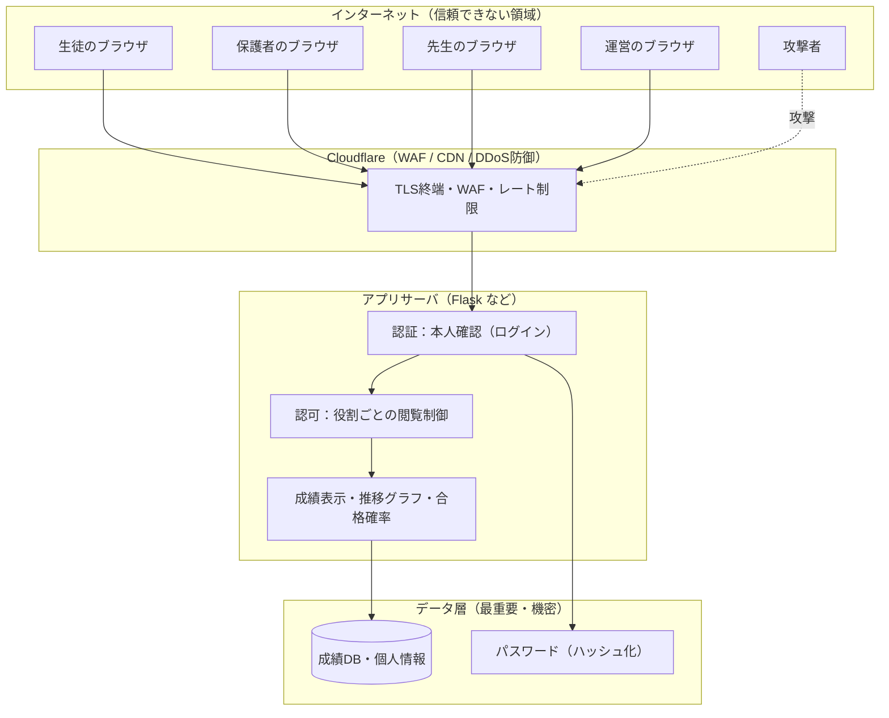

# 学習塾 成績管理アプリ — 設計と脅威分析（Day20 課題）

2026-11-16 / 生成AIセキュア開発講座

## 1. 要件

- 生徒：自分の成績を見れる／自分の成績の推移を見れる
- 保護者：自分の子供の成績の推移を見れる
- 先生：すべての子供の成績の推移を見れる
- 運営：すべての子供の成績の推移 ＋ 志望校への合格確率を見れる

→ ポイントは「**誰が・誰のデータを・どこまで**見られるか」。役割（ロール）ごとに境界がある。

## 2. 構成図（アーキテクチャ）

## 3. 信頼境界（Trust Boundary）

| # | 境界 | 「信頼できない側」→「信頼できる側」 |
|---|---|---|
| B1 | インターネット ↔ Cloudflare | 外の全員（攻撃者含む）が入ってくる最前線 |
| B2 | Cloudflare ↔ アプリサーバ | 認証を通った人だけが中に入れる |
| B3 | アプリ ↔ データ層 | アプリ経由でしかDBに触れない |
| B4 | **役割間（アプリ内の認可）** | 生徒・保護者・先生・運営で見える範囲が違う ← **今回の肝** |

## 4. 脅威と対策（STRIDE で洗い出し）

STRIDE = なりすまし / 改ざん / 否認 / 情報漏洩 / サービス妨害 / 権限昇格

| 境界 | 脅威(STRIDE) | 具体例 | 対策 |
|---|---|---|---|
| B1 | **D** サービス妨害 | 大量アクセスでサイトを落とす | Cloudflareのレート制限・DDoS防御 ←「クラウドフレアなんちゃら」の正体 |
| B1 | **I** 情報漏洩 | 通信を盗聴して成績を覗く | HTTPS(TLS)を必須にする |
| B1 | **S** なりすまし | 他人のID/PWでログイン | 強いパスワード＋多要素認証(MFA)、ログイン試行の制限 |
| B4 | **E** 権限昇格 | 生徒が運営ページ(合格確率)を見る | サーバ側で毎回ロールを確認。画面を隠すだけでは不十分 |
| B4 | **I** 情報漏洩(IDOR) | URLのIDを書き換えて他人の成績を見る | リクエストごとに「この人はこのデータを見てよいか」を照合 |
| B3 | **T** 改ざん | SQLインジェクションで点数を書換 | パラメータ化クエリ（値を直接文字列に入れない） |
| B3 | **I** 情報漏洩 | DBが平文で丸見え | パスワードはハッシュ化、個人情報は暗号化 |
| B3/B4 | **R** 否認 | 誰が成績を変えたか不明 | 監査ログ（いつ・誰が・何をしたか記録） |

## 5. 「全部やってたら終わらない」問題への折り合い

IPAの指南書もここを認める。答えは **優先順位**：

- 全部やらない。**ビジネス被害の大きいものから**つぶす
- このアプリで一番痛いのは「**他人の成績・合格確率の漏洩**」= B4（認可）。まずここ
- 設計図は**後で変えてOK**。完璧を目指さず、まず1枚描いて叩き台にする
- 下流は自動化（CI＋静的解析）に任せ、人は上流の判断に集中する＝シフトレフト

## 6. 進め方

- **今日(〜20:00)**：この design.md を仕上げて Slack / X に投稿（いぐおさんがレビュー）
- **月水金**：この図に沿って実装 → 各対策を満たしながら作る → 最後プレゼン
